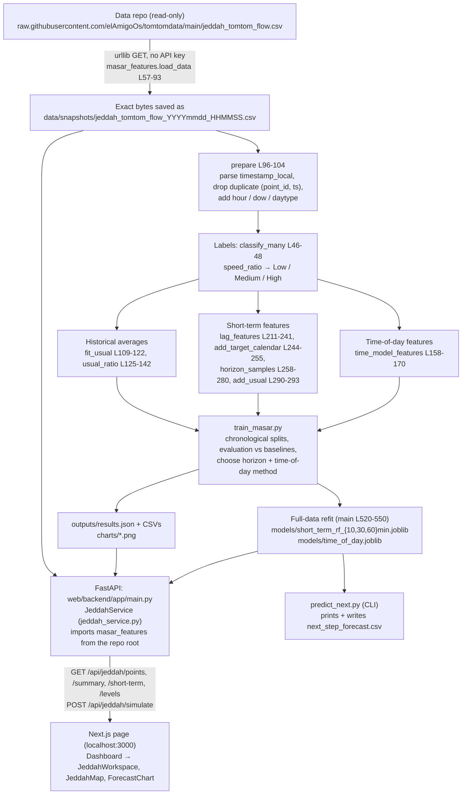

# Masar prototype — end-to-end system trace

**State traced:** commit `999dafe`, plus the five follow-up fixes (percent truncation, exact delay, data coverage, date note, input validation and generated texts), on 13 Oct 2026.
**Training snapshot:** `data/snapshots/jeddah_tomtom_flow_20261013_172552.csv` (11,150 rows).

**How to read this document.**
- Plain statements describe **what the code does**. Each one cites `file:function` and line numbers.
- Paragraphs marked **Interpretation:** are my reading of what it means.
- **Hardcoded**, **Assumption** and **Not implemented** are flagged explicitly where they apply.
- Numbers come from the committed `outputs/results.json`, or were recomputed read-only with the same functions on the training snapshot.

---

## 1. Overview

### 1.1 Pipeline

### 1.2 Files involved

| File | Role |
|---|---|
| `masar_features.py` | The single shared module. It holds the data URL, thresholds and constants, `load_data` / `prepare`, the labels, historical averages, time-model features, short-term features and target construction. Training, `predict_next.py` and the backend all import it. |
| `train_masar.py` | Audit, chronological splits, evaluation of every method, method/horizon selection, charts, full-data refit, `outputs/results.json`. |
| `predict_next.py` | CLI: loads a full-data RF and forecasts +h min from the newest reading of each point. |
| `data/snapshots/*.csv` | Dated copies of the downloaded CSV (gitignored). The backend reads the one named in `results.json → data.snapshot`. |
| `models/short_term_rf_{10,30,60}min.joblib` | Full-data Random Forest pipelines, plus the `usual` tables and the feature list. |
| `models/time_of_day.joblib` | The selected time-of-day method's state: `method`, `usual` tables and the HGB model. |
| `outputs/results.json` | Data info, audit, splits, all results, the selected horizon/method, and the `models` (evaluated vs full-data) periods. The web app reads it. |
| `outputs/*.csv`, `outputs/data_audit.json` | Result tables, confusion matrices, audit files, feature importance, latest forecast. |
| `charts/*.png` | Static report figures. The web page does not show them. |
| `web/backend/app/main.py` | FastAPI app and endpoints (Jeddah plus the older NYC endpoints). |
| `web/backend/app/schemas.py` | Request models (`JeddahSimulationRequest`, L13-16). |
| `web/backend/app/services/jeddah_service.py` | Serves Jeddah: point catalog, time-of-day predictions, simulation output, next-hour forecast, summary. |
| `web/backend/scripts/build_jeddah.py` | Checks that the artifacts exist; runs `train_masar.py` with `--retrain` or when something is missing. |
| `web/frontend/src/app/page.tsx`, `components/Dashboard.tsx` | Page shell; `city` state defaults to `"jeddah"`. |
| `web/frontend/src/components/JeddahWorkspace.tsx` | All Jeddah controls, cards, tables and texts. |
| `web/frontend/src/components/JeddahMap.tsx` | MapLibre map with 10 coloured dots. |
| `web/frontend/src/components/ForecastChart.tsx` | Recharts area chart for the 12-hour forecast. |
| `web/frontend/src/components/CitySelect.tsx` | City dropdown; NYC is hidden with `SHOW_NYC = false`. |
| `web/frontend/src/lib/jeddah.ts`, `lib/api.ts`, `lib/format.ts`, `lib/maplibre.ts` | API client and types; `API_BASE` (default `http://127.0.0.1:8000`); date formatting (en-GB); MapLibre worker URL. |

---

## 2. Reading the data

### 2.1 Source and snapshots
- `DATA_URL` is **hardcoded** at `masar_features.py` L23 as the raw GitHub CSV of `elAmigoOs/tomtomdata`. No TomTom API is called anywhere in this repo: the only network read is `urllib.request.urlopen(DATA_URL)` (L68).
- `load_data(csv=None, snapshot_dir)` (L57-93): with no `--csv`, it downloads the file and writes the **exact bytes** to `snapshot_dir/jeddah_tomtom_flow_<local time of download>.csv` (L71-76), then parses them. With `--csv path`, it reads that file instead and saves nothing (L78-80).
- `train_masar.py main` passes `--snapshot-dir` (default `data/snapshots`, L462). `predict_next.py` calls `load_data(args.csv)` **without** a snapshot dir (L29), so its downloads are not saved.
- The snapshot used now is `data/snapshots/jeddah_tomtom_flow_20261013_172552.csv`. `results.json → data.snapshot` and `data.source` both point to it, because the last training run was a `--csv` re-run on that snapshot (identical results).
  - **Interpretation:** `data.source` therefore shows the local path, not the GitHub URL. The URL is only visible in the run log and in the report.
- The backend reads that same file again at start-up (`jeddah_service.py __init__` L46). It needs it for the lag features of the next-hour forecast and for the point catalog.
- **Assumption:** raw.githubusercontent.com can lag ~5 min behind the data repo. The code does not check freshness.

### 2.2 CSV columns (22 in the file)

| Used | Where |
|---|---|
| `timestamp_local` | Parsed into `ts` (`prepare` L98). The only time column used. |
| `point_id`, `road` | Keys and labels everywhere. |
| `speed_ratio` | Labels, targets, features, averages. **Taken from the CSV as is, not recomputed.** |
| `current_speed_kmh`, `delay_s` | Short-term lag features (`LAG_COLUMNS` L195). `current_speed_kmh` is also the target of the speed-error metric (`train_masar.evaluate_time_of_day` L271) and the "weekday average" in the catalog. |
| `free_flow_speed_kmh` | Feature in both models; converts ratio → km/h. |
| `free_flow_travel_time_s` | Only in the backend catalog: median per point → "Expected delay" (`jeddah_service._build_catalog` L74). |
| `frc` | Time-model feature `frc_code` (L153-155) and the catalog label. |
| `lat`, `lon` | Map dot position (catalog L70-71). |
| `road_closure` | Audit only: rows written to `outputs/road_closure_rows_for_review.csv` (`audit` L301). Not used as a feature. |

**Ignored:** `timestamp_utc`, `date_local`, `hour_local`, `day_of_week`, `is_weekend`, `seg_lat`, `seg_lon`, `current_travel_time_s`, `confidence`.
- `congestion_level` from the CSV is **overwritten** by `prepare` L103 with the repo's own classification. On this snapshot both agree on 100% of rows.
- `is_weekend` in the CSV also agrees 100% with the code's Fri/Sat rule.

### 2.3 Timezone
- The code uses `timestamp_local` as a **naive** datetime. No timezone conversion happens anywhere.
- In this snapshot `timestamp_local − timestamp_utc` is exactly +3:00 for all 11,150 rows (Saudi time, no DST).
- **Assumption:** the collector writes Saudi local time into `timestamp_local`. The browser also parses these strings as naive local times (`format.ts toDate` L9-11), so the displayed wall-clock time is the same in any browser timezone.
- `defaultDate()` (`JeddahWorkspace.tsx` L37-41) uses the **browser's** today, so a viewer outside UTC+3 near midnight could get a different default day.

### 2.4 Cleaning — what is and is not done

`prepare` (`masar_features.py` L103-135) validates each row before removing duplicates. Each dropped row is counted under the first rule it fails. The counts are kept in `d.attrs["rows_dropped"]` and copied into `info["rows_dropped"]` by `load_data` (L94). `train_masar.py` writes them to `outputs/data_audit.json` (`audit` L297, key `rows_dropped`) and to `results.json` (`data.rows_dropped` and `data.audit.rows_dropped`).

| Rule (in order) | Code | Rows removed on this snapshot |
|---|---|---|
| `speed_ratio` missing | `prepare` L108-118 | **0** |
| `speed_ratio` ≤ 0 or > 1 | same | **0** (min 0.1786, max 1.0) |
| `current_speed_kmh` missing or ≤ 0 | same | **0** |
| `free_flow_speed_kmh` missing or ≤ 0 | same | **0** |
| Duplicate `(point_id, ts)` | L127 `drop_duplicates` | **0** |
| Collection gaps | Rows are **not** removed. Gaps are handled in the features (lags across a gap → NaN, `lag_features`) and in the target (`merge_asof` tolerance ±5 min, `horizon_samples`). | 0 |

- Rows after `prepare`: **11,150 = 11,150 raw** (`rows_raw`), in 1,115 runs × 10 points.
- Other columns (`delay_s`, travel times, `frc`, coordinates) are **not validated**. They are clean in this snapshot (no NaN in any column).
- **Gaps > 15 min:** 6, all on 5–7 Oct (`outputs/gaps_over_15min.csv`): 92.3, 61.5 and 37.5 min on the evening of 5 Oct, 15.2 min just after midnight, and 19.7 + 19.9 min on 7 Oct.
  - The code does not know their cause. The 5 Oct gaps match the GitHub-side collection outage mentioned by the team (**Interpretation**).
- Gap effect on samples:
  - 70 readings have no valid lag-1, and 220 have no valid lag-6.
  - `horizon_samples` drops readings with no target within ±5 min: 70 at +10 min, 80 at +30 min and 100 at +60 min. That includes each point's last reading(s), whose future does not exist yet.
- **NaN labels:** `classify` (L38-45) and `classify_many` (L48-55) now **raise `ValueError`** on a NaN ratio, instead of silently returning "High" (`NaN >= x` is False). With the row validation above, a NaN can no longer reach them from the CSV.
- Speed ratio is capped at 1.0 by the collector: 66.9% of readings are exactly 1.0.

---

## 3. Labels

- `speed_ratio` = current speed / free-flow speed. **It is computed by the collector, not by this repo.** It matches `current_speed_kmh / free_flow_speed_kmh` to within 5·10⁻⁵ (rounding to 4 decimals).
- Thresholds are **hardcoded** in `masar_features.py` L26-27: `LOW_MIN_RATIO = 0.85`, `MEDIUM_MIN_RATIO = 0.60`.
- Rules (`classify` L38-45; vectorised `classify_many` L48-55; both raise on NaN):
  - ratio ≥ 0.85 → **Low**
  - 0.60 ≤ ratio < 0.85 → **Medium**
  - ratio < 0.60 → **High**
  - Exactly 0.60 is Medium.
- Day type: `day_type` (L51-52) gives weekend for pandas `dayofweek` ∈ {4, 5} (Fri, Sat), set by `WEEKEND_DAYS` L28 (**hardcoded**). Everything else, including Sunday, is weekday.
- Final distribution (all 11,150 readings, `outputs/label_distribution.csv`): **Low 7,936 (71.2%) · Medium 2,235 (20.0%) · High 979 (8.8%)**.
- High per point (`outputs/label_counts_by_point.csv`):
  - Al Haramain 1: 0, 2: 256, 3: 176
  - Al Madinah 1: 0, 2: 28, 3: 188, 4: 144
  - King Abdulaziz 1: 155, 2: 7, 3: 25

---

## 4. Features

### 4.1 Time-of-day model (`TIME_MODEL_FEATURES` L147-150, built by `time_model_features` L158-170)

| Feature | Computation | Notes |
|---|---|---|
| `minute_sin`, `minute_cos` | sin/cos(2π · minute-of-day / 1440) of the reading time | Cyclic time of day. |
| `is_weekend` | 1 if Fri/Sat | The only calendar input; there is no day of week (removed on purpose). |
| `free_flow_speed_kmh` | From the row | Training: the per-reading value. Serving: the **median** per point (`_ratios` L95). |
| `frc_code` | Digits of `frc` ("FRC3" → 3; 9 if none) | Constant per point. |
| `point_mean` | Mean `speed_ratio` of the point, from `usual["point"]` | Fitted on the training readings. |
| `point_hour_mean` | `usual_ratio(..., by_daytype=False)` → point × hour mean over **all days** (weekday and weekend mixed) | Fitted on the training readings. |

Used by the HGB time-of-day model only.

### 4.2 Short-term Random Forest (`SHORT_TERM_FEATURES` L197-208)

There are 36 inputs (35 numeric + `point_id`, which is one-hot encoded to 10 columns in `make_rf` L58-62).

| Feature(s) | Computation (`lag_features` L211-241, `add_target_calendar` L244-255, `add_usual` L290-293) |
|---|---|
| `speed_ratio_t`, `current_speed_kmh_t`, `delay_s_t` | Values of the reading at time t. |
| `<col>_lag1 … _lag6` (18) | Value k readings earlier for the same point. Kept only if it is at most k·10 + 5 min older (L224); otherwise NaN. |
| `ratio_roll3_mean/std`, `ratio_roll6_mean/std` | NaN-ignoring mean/std over [t, lag1, lag2] and [t … lag5] (L233-236). |
| `delay_roll3_mean` | NaN-ignoring mean of `delay_s` over t, lag1, lag2. |
| `ratio_change`, `speed_change`, `delay_change` | Value at t minus lag1 (NaN across a gap). |
| `free_flow_speed_kmh` | Of the reading at t. |
| `target_hour_sin/cos` | sin/cos of the minute-of-day of **t + horizon**. |
| `target_dow` | Day of week of t + horizon (0 = Mon). |
| `target_is_weekend` | 1 if t + horizon is Fri/Sat. |
| `usual_ratio_target` | Historical average for (point, hour of t + h, day type of t + h), with fallbacks (`usual_ratio` L125-142). |
| `point_id` | One-hot. |

### 4.3 Historical-average tables (`fit_usual` L109-122)
- The tables are: `global`, `point`, `point_hour`, `point_hour_daytype`, plus `_days` (distinct dates), `_p25` and `_p75` per (point, hour, day type).
- `usual_ratio` lookup order: point × hour × day type → point × hour → point → global.
- **Sunday rule:** Sunday is a weekday day type, so it uses the weekday table. It never uses weekend days.

### 4.4 Leakage controls (what the code does)
- **Future data in features:** lags only look backwards (`shift(k)` ≥ 1). The target is a separate reading at t + h matched by time (`merge_asof`, nearest within ±5 min, L269-277), never by row offset.
- **Gaps:** a lag older than k·10 + 5 min becomes NaN (L224-226). A target with no reading within ±5 min is dropped (L278). A sample is never paired with a reading from much later.
- **Train/test overlap:**
  - `samples_split` (`train_masar.py` L114-119) keeps a training sample only if its **target time** is before the cut. A test sample needs t inside the test window and its target before the end.
  - `readings_split` (L108-111) splits readings at the same cut.
  - The `usual` tables and the HGB model are fitted only on the training readings of each split (`evaluate_short_term` L154; `time_of_day_states` L250-252 called with the train part, L263-265).
- **Interpretation:** two milder effects remain, both inside the training data rather than leaks into the test.
  - Test samples at the very start of the test window use lags from the last training readings. That is legitimate, since they are known at time t.
  - `usual_ratio_target` / `point_hour_mean` are averages that include the training sample's own period (in-sample target encoding). That can make the model lean on them more than on unseen days. This is the most important RF feature (see §8).

---

## 5. Training

### 5a) Time-of-day model
- **Target:** `speed_ratio` of each reading (regression). `time_of_day_states` L252: `make_time_model().fit(time_model_features(train, usual), train["speed_ratio"])`.
- **Model** (`make_time_model` L70-73): `HistGradientBoostingRegressor(max_iter=200, learning_rate=0.05, max_leaf_nodes=15, l2_regularization=1.0, random_state=42)`. **Hardcoded**, not tuned.
- **Prediction:** `time_of_day_ratio` (L180-190) clips to [0, 1]. Speed in km/h = ratio × free-flow speed.

### 5b) Short-term Random Forest (+10 / +30 / +60 min)
- **Target per horizon:** `horizon_samples(d, h)` (L258-280).
  - `target_time = ts + h`. The nearest reading of the same point within ±5 min (`TOLERANCE_MIN` L31) supplies `target_ratio`. `target_level = classify_many(target_ratio)`.
  - **If the future reading is missing**, the sample is **dropped** (L278). Nothing is imputed.
- **Model** (`make_rf` L57-67): one-hot `point_id` + passthrough numeric → `RandomForestClassifier(n_estimators=300, max_depth=12, min_samples_leaf=5, class_weight="balanced", random_state=42, n_jobs=-1)`. **Hardcoded**, not tuned. NaN features are allowed: scikit-learn ≥ 1.4 RF supports missing values, and 1.9.1 is installed in both the repo and backend environments.
- One RF is trained per horizon and per split (`evaluate_short_term` L150-176).

### 5c) Baselines and other models
- **Persistence:** predicted level = level at t (`congestion_level` of the latest reading, L159).
- **Historical average (short term):** `classify_many(usual_ratio_target)`, i.e. point × hour × day-type average at t + h (L160).
- **Time-of-day baselines:** `avg_point_hour` (by_daytype = False) and `avg_point_hour_daytype` (`time_of_day_ratio` L187-190).
- **Other models (LR, DT, LSTM…): not implemented.** Only HGB and RF are trained. LSTM/GRU are listed as a later step in `PILOT_REPORT.md`.

### Splits (`define_splits` L78-105)

| Split | Rule (code) | Train | Test | Readings train / test | RF samples at +60 min (train / test) |
|---|---|---|---|---|---|
| `holdout` "Last 4 days (Sat 10 Oct – Tue 13 Oct)" | Midnight of the latest Fri/Sat that still leaves ≥ 3 days of data to the end (L92-104) | 5 Oct 20:29 → 9 Oct 23:50 | 10 Oct 00:00 → 13 Oct 17:20 | 5,780 / 5,370 | 5,680 / 5,310 (3,930 weekday + 1,380 weekend) |
| `latest` "Latest 20% of time" | Cut at the 80th percentile of unique timestamps (L79-87) | 5 Oct 20:29 → 12 Oct 04:10 | 12 Oct 04:20 → 13 Oct 17:20 | 8,920 / 2,230 | 8,820 / 2,170 (weekday only) |

- At +10 / +30 min the holdout test has 5,360 / 5,340 samples.
- The UI shows the second split as "Latest 20% (weekday)": `testLabel` (`JeddahWorkspace.tsx` L173-179) appends the day types present.
- **Interpretation:** "latest" lies inside the holdout period, so it is not an independent test.
- **Subsets** (`subsets` L122-128): when a test contains both day types, results are also computed for weekday-only and weekend-only rows. Short-term uses the day type of the **target time**; time-of-day uses the day type of the reading.

### Metrics (`scores` L133-145, `evaluate_time_of_day` L260-275)
- **Macro-F1:** unweighted mean of per-class F1 over the classes present in y_true or y_pred.
- **Accuracy (level accuracy):** share of correct levels.
- **High recall:** correctly predicted High / actual High (NaN if there are no High readings).
- **MAE (speed error):** mean |observed `current_speed_kmh` − predicted ratio × the reading's `free_flow_speed_kmh`| in km/h. MAE of the ratio is also stored.
- Confusion matrices: L171-175 → `outputs/confusion_matrices.csv`, `charts/confusion_*`.

### Choosing what the app uses
- **Horizon** (`choose_horizon` L179-245):
  - It picks the horizon with the largest (RF − persistence) macro-F1 on the primary split `holdout`. Result: **+60 min**, margin 0.716 − 0.680.
  - It is called "beats" only if the margin is > `F1_NOISE = 0.01` (L52, **hardcoded**) and the margin is > 0 on every other split.
  - Caveats are appended for lower High recall, a day-type subset where RF < persistence (here the weekend: 0.595 vs 0.624), and horizons that do not beat persistence.
- **Time-of-day method** (`choose_time_method` L278-290): lowest MAE km/h on `holdout` / all rows. Result: **HGB time model**, ±4.37 km/h (vs ±4.72 point × hour × day type, ±6.22 point × hour).

### Full-data refit (`main` L520-550)
- After evaluation, the code refits on **all** 11,150 readings: `usual_all = fit_usual(d)`.
- For each horizon it fits an RF on `horizon_samples(d, h)` (11,050 samples at +60 min). It saves `{pipeline, features, horizon_min, usual, trained_from, trained_through}` to `models/short_term_rf_{h}min.joblib`.
- It saves the selected time-of-day state, `{method, usual, model, label, trained_from, trained_through}`, to `models/time_of_day.joblib`.
- `results.json → models` records the evaluated period (train 5 Oct 20:29 → 9 Oct 23:50, test 10 Oct 00:00 → 13 Oct 17:20) and the full-data period (5 Oct 20:29 → 13 Oct 17:20, 11,150 rows).
- **The full-data models have no score of their own.** All metrics come from the evaluated models.
- Also written: `outputs/latest_forecast.csv` (L533-542) and the impurity feature importance of the selected-horizon full-data RF (`chart_importance` L431-443).

---

## 6. `predict_next.py` and the backend

### `predict_next.py` (L20-49)
- **Arguments:** `--horizon {10,30,60}` (default 30), `--csv`, `--model`, `--out` (default `next_step_forecast.csv`).
- **Steps:**
  1. Loads the full-data RF bundle.
  2. Loads the data: the URL without saving a snapshot, or `--csv`.
  3. Builds `latest_samples` (the newest reading per point) and adds `usual_ratio_target` from the **bundle's** `usual` table.
  4. Runs `predict_proba` and outputs the latest level (= persistence), the predicted level (argmax), `prob_*` and `model_probability` = the max class probability.
- It does not retrain.

### Backend start-up (`jeddah_service.py JeddahService.__init__` L43-53)
- It reads `outputs/results.json`, the snapshot named in it (re-running `prepare`), `models/time_of_day.joblib` and `models/short_term_rf_{selected horizon}min.joblib`.
- It precomputes the next-hour forecast once (`_short_term_forecast` L186-211).
- The service is cached with `lru_cache` (L244-246), so a **backend restart is needed** after retraining.
- If a file is missing, endpoints return HTTP 503 (`main.py _jeddah` L139-146).

### Jeddah endpoints (`web/backend/app/main.py`)

| Endpoint | Input | Output | Uses |
|---|---|---|---|
| `GET /api/jeddah/summary` (L149-151) | — | `data` (period, rows, days, weekday/weekend day lists), `models`, `splits`, short-term and time-of-day `methods` / `selected` / `results` (all subsets) | `results.json` only (`summary` L215-241) |
| `GET /api/jeddah/points` (L154-156) | — | 10 catalog entries (id, road, label, lat/lon, frc, median free-flow speed and travel time, weekday average speed, weekday peak hour and level) | Snapshot readings (`_build_catalog` L57-79) |
| `GET /api/jeddah/short-term` (L159-161) | — | horizon, latest timestamp, selection sentence, per point: latest/persistence level, predicted level, `model_probability`, all probabilities | Full-data RF + snapshot (precomputed at start-up) |
| `GET /api/jeddah/levels?date&hour` (L164-166) | date, hour 0–23 | Per point: hour-mean ratio, km/h and level | Time-of-day model (`levels` L99-111); `speed_ratio` is sent unrounded |
| `POST /api/jeddah/simulate` (L169-174) | `{point_id, date, hour}` (`schemas.py` L13-16) | Cards (unrounded `predicted_speed_ratio`, exact travel times in seconds), range, `data_coverage`, method, 12-hour forecast, that point's next-hour forecast | Time-of-day model, `usual` tables, catalog (`simulate` L116-166) |

The older NYC endpoints (`/api/summary`, `/api/roads…`, `/api/simulate`, `/api/police/snapshot`, `/api/scenario`, `/health`) are still present but not reachable from the Jeddah-only UI.

---

## 7. Every number on the page

The page loads `points`, `summary` and `short-term` once (`JeddahWorkspace.tsx` L113).
- The default point is the first point (in API order) whose `weekday_peak_level` is High → **Al Haramain Rd · Point 2**.
- The default hour is 17 (L105, **hardcoded**). The default date is today, or the next Sun–Thu if today is Fri/Sat (`defaultDate`).
- The map reloads `/levels` whenever the date or hour changes. The cards appear after **Predict traffic** calls `/simulate`.

### Hour-level prediction used by the cards, map and chart (`_ratios`, `jeddah_service.py` L85-97)
- For a point and an hour, the code builds six rows at minutes :00, :10, …, :50, using the point's **median** free-flow speed and its FRC.
- It predicts each slot with the time-of-day model and **averages the six ratios**. The result is the hour's ratio `r`, which the API sends **unrounded**.

**Ratio percentages** everywhere use `ratioPercent` (`lib/format.ts` L49-53). It formats `r × 100` with one decimal, **truncated, not rounded**, so the percentage always agrees with the level: 0.5997 → 59.9% (High), 0.85 → 85.0% (Low). The only ratio percentages on the page are the "Speed vs free flow" card and the map popup; the tables show F1, recall, accuracy and model probability, which are not speed ratios.

| UI element | Calculation |
|---|---|
| **Expected speed** | `predicted_speed_kmh = round(r × median free-flow speed, 1)` (`simulate` L113+), shown rounded to an integer. The sub-line shows the median free-flow speed. |
| **Congestion level** | `classify(r)` on the unrounded `r`. |
| **"53–64 km/h on past weekdays at this hour"** | `p25` and `p75` of all 10-minute `speed_ratio` readings for (point, hour, day type) in the **full-data** `usual` table, × median free-flow speed, rounded. It is the **interquartile range** (middle 50%) over all collected days, not a min–max range and not a model interval. |
| **Speed vs free flow** (L425) | `ratioPercent(predicted_speed_ratio)`. The hint "Low ≥ 85% · High < 60%" is **hardcoded** text matching `LOW_MIN_RATIO` / `MEDIUM_MIN_RATIO`. |
| **Expected delay** (`delayText` L58-69) | The backend sends the exact `expected_travel_time_s = fftt / max(r, 0.05)` (L124) and `free_flow_travel_time_s = fftt` (the median per point), both unrounded. The frontend works in minutes when either is ≥ 120 s. It rounds **once**: `delay = round((travel − fftt) / 60)`, and `free = round(fftt / 60)`. The text is "+{delay} min ({free + delay} min instead of {free} min at free flow)", so both parts always agree. The segment length is **not** in the data or the code (**Interpretation:** implied length = speed × time ≈ 19.3 km for Al Haramain 2). |
| **Date note** (L444-449) | It always says "This prediction depends only on the day type (weekday/weekend) and the hour, not on the specific date." It adds "This is a prediction, not the observed value." if the selected hour had fully passed when Predict was pressed (`selectedIsPast` L227-229, compared with the click time `predictedAt`). |
| **"High at weekday peak"** badge | `classify(min over hours of the mean weekday speed_ratio)` for that point, over **all** weekday readings in the snapshot (`_build_catalog`). Raw observed data, not a model. |
| **"Usually slowest on weekdays around HH:00"** | The hour of that minimum (`weekday_peak_hour`). |
| **"… km/h weekday average"** | Mean `current_speed_kmh` of all weekday readings of the point. |
| **"Pick one of Masar's 10 TomTom measurement points on 3 roads"** (L266) | Both counts come from the catalog: `points.length` and the number of distinct roads. The map status line (`JeddahMap.tsx` L178) is computed the same way. |
| **12-hour chart** (`ForecastChart.tsx`) | `simulate`: hours h … h+11 (wrapping past midnight into the next day), each from `_ratios` → km/h, rounded. Only the speed is drawn; the per-hour level is sent but **not shown**. The chip shows the method label. |
| **"Data coverage: 6 weekdays observed at this hour."** (L469-470) | `_coverage` (`jeddah_service.py` L165-185): `days` = number of distinct dates with readings for (point, hour, day type) in the full-data table. It is a count, not a confidence; there is no Medium/Low wording. The note is added for a weekday never collected, and when `days = 0` ("falls back to the all-days average for this hour"). |
| **Map dot colours** (`JeddahMap.tsx`) | `/levels` for the selected date and hour → `classify(r)` per point → red High `#d64f49`, amber Medium `#d6a13b`, green Low `#269b72`, grey if unknown. The hover popup shows "label — level · km/h (xx.x% of free flow)" with `ratioPercent` (L44, L129). The selected dot is drawn bigger. |
| **Weekend note / badge** | Shown when the chosen date is Fri/Sat (browser `getDay`). **Hardcoded** text. |
| **Footnote / "Data: 5–13 Oct 2026, 9 days"** | `first_reading`, `trained_through`, `days`, `rows` from `results.json`. |

### Next-hour section (`NextHourCard` L71+, section title L482)
- **Titles:** the section title and the card label come from `horizonTitle(horizon)` (`format.ts` L56-58): "Next hour" for 60 min, otherwise "Next 30 min" / "Next 10 min".
- **Latest reading / Forecast for:** `latest_timestamp` (max over points) and `forecast_for` = latest `ts` + horizon (`_short_term_forecast` L187+).
- **Latest (= persistence):** `congestion_level` of the point's newest reading, i.e. `classify(speed_ratio)`.
- **+60 min model:** argmax of `predict_proba` of the full-data RF on `latest_samples`.
- **Model probability:** `max(predict_proba)`, i.e. the forest's average vote share for the predicted class. **Not calibrated.** It is shown as a rounded percentage because it is not a speed ratio.
- **Note under the table** (`horizonNote` L232-239): built from `results.json → short_term.selected.horizons_not_beating_persistence` (written by `choose_horizon`: horizons whose margin is ≤ `F1_NOISE`). Today it reads "At +10 and +30 min the model does not beat persistence on the main test, so only +60 min is shown."
- **When the card is next to the selected-time cards:** only if |selected date-hour − latest reading| ≤ 2 h (`nearLatest` L219, **hardcoded** 2 h).

### "How the prediction works" section
- The tables come straight from `results.json` (`summary`), sorted by split and subset. The selected rows are highlighted using `selected.method` and `selected.horizon_min`.
- The verdict sentence is generated in `choose_horizon`.
- **Weekend note** under the short-term table (`weekendNote` L241-258): built from `splits[primary].test_weekend_days` (written by `train_masar.py main`, L510) and the weekend `support_High` of the selected horizon. Today it reads "The weekend part of the main test is a single weekend day (Sat 10 Oct) with 9 High readings at +60 min, so its numbers are especially noisy." "Especially noisy" is added when there are fewer than 30 High readings (**hardcoded** threshold).
- The `/simulate` `notice` text was **removed** from the API. The page already says "Pilot data — not live traffic", and the removed sentence ("Only a few days of data so far") would have gone stale.

---

## 8. Congestion causes / explanations

**What the system tells the user about why traffic is congested: essentially nothing causal.** Shown today:
- **When:** the level and speed for the selected hour, the weekday peak hour and the 12-hour curve. This is a time-of-day pattern, not a cause.
- **Weekday vs weekend:** the weekend note and badge, and the day-type range.
- **Recent state:** the Next-hour table shows the latest level vs the model forecast. No trend arrow or explanation text exists.

**Feature importance / SHAP:**
- Impurity-based importance of the full-data +60 min RF is computed (`train_masar.chart_importance` L431-443). It is written to `outputs/random_forest_feature_importance.csv` and `charts/random_forest_feature_importance.png`, and **is not shown in the UI**.
- Top features: `usual_ratio_target` 0.228, `speed_ratio_t` 0.079, `current_speed_kmh_t` 0.067, `ratio_roll3_mean` 0.054, `target_hour_cos` 0.049, `speed_ratio_lag1` 0.047, `delay_s_t` 0.045.
- **SHAP: not implemented.** There is no per-prediction explanation, and the time-of-day HGB has no importance output.

**Incidents:** `jeddah_incidents.csv` is **not referenced anywhere** in this repo's code (searched all tracked files). `road_closure` from the flow CSV is only written to an audit file. The NYC "accident" text in `web/backend/app/services/simulator.py` belongs to the hidden NYC view.

**Cause explanation is not implemented.** Existing pieces that could support it later (nothing implemented here):
1. The `usual` tables already give "usual for this hour and day type". The deviation (latest ratio − usual) would separate "normal rush hour" from "unusual congestion".
2. The lag / `ratio_change` / rolling features already describe the recent trend (worsening vs recovering).
3. RF feature importance exists globally. Per-prediction SHAP (TreeExplainer) on the RF would be the next step.
4. `road_closure` flags and an incidents feed (`jeddah_incidents.csv` in the data repo) could be joined by time and point once the data is validated (the 6 closure rows look unreliable: normal speeds).
5. The point catalog has FRC and free-flow speed (road class / capacity context).

---

## 9. Worked examples (real values, recomputed read-only)

### 9a) Al Haramain Rd · Point 2, Wed 14 Oct 2026, 17:00 → 55 km/h, High, 60%, +8 min

1. **Catalog** (`_build_catalog`), over 1,115 readings of this point:
   - median free-flow speed **92.0 km/h**, median free-flow travel time **756 s**, FRC0
   - weekday average 69.8 km/h
   - weekday hourly mean ratio is lowest at **07:00 (0.531 → High)**, so the badge is "High at weekday peak" and the hint is "Usually slowest on weekdays around 07:00"
2. **Day type:** Wednesday → weekday (`simulate` L129).
3. **Time-model features**, six slots 17:00 … 17:50 (`time_model_features`):
   - `is_weekend` 0, `free_flow_speed_kmh` 92.0, `frc_code` 0
   - `point_mean` 0.7958, `point_hour_mean` 0.6426 (all-days 17:00 mean)
   - `minute_sin/cos` from (−0.966, −0.259) at 17:00 to (−0.999, −0.044) at 17:50
4. **HGB per slot:** 0.6079, 0.5907, 0.5910, 0.5947, 0.5950, 0.6192 → **mean r = 0.59973**.
5. **Expected speed:** 0.59973 × 92 = 55.18 → API 55.2 → card **55 km/h**.
6. **Level:** `classify(0.59973)` → 0.59973 < 0.60 → **High**.
7. **Speed vs free flow:** the API sends r = 0.599732 unrounded; `ratioPercent` truncates it to **59.9%**, which agrees with High (< 60%).
8. **Delay:**
   - travel = 756 / 0.599732 = 1,260.56 s (sent unrounded)
   - delay = (1,260.56 − 756) / 60 = 8.41 → **+8 min**
   - free flow 756 / 60 = 12.6 → 13 min
   - shown as "(21 min instead of 13 min at free flow)", where 21 = 13 + 8
9. **Range:** `usual` (full data), weekday, 17:00 → p25 0.5714, p75 0.6923, × 92 = 52.6 – 63.7 → **"53–64 km/h on past weekdays at this hour"**. For comparison, the weekday 17:00 table mean is 0.6245.
10. **Data coverage:** 6 distinct weekdays observed at 17:00 (Tue 6, Wed 7, Thu 8, Sun 11, Mon 12, Tue 13) → "**Data coverage: 6 weekdays observed at this hour.**" There is no note, because Wednesday has been collected and there is data at 17:00.
11. **Date note:** "This prediction depends only on the day type (weekday) and the hour, not on the specific date." 14 Oct is in the future, so there is no "not the observed value" line.
12. **12-hour chart (km/h):**

    | 17 | 18 | 19 | 20 | 21 | 22 | 23 | 00 | 01 | 02 | 03 | 04 |
    |---|---|---|---|---|---|---|---|---|---|---|---|
    | 55.2 | 66.8 | 65.0 | 79.6 | 81.3 | 81.5 | 85.0 | 88.2 | 89.6 | 91.2 | 92.0 | 92.0 |

13. **Map dot:** `/levels` (same calculation) → High (red), popup "… — High · 55 km/h (59.9% of free flow)".
    - Other points at that hour: Al Haramain 3 High, Al Madinah 3 High, Al Madinah 4 High, King Abdulaziz 1 High, King Abdulaziz 2 Medium, King Abdulaziz 3 Medium, Al Haramain 1 Low (r = 0.8504 → 85.0%, just at the boundary), Al Madinah 1 Low, Al Madinah 2 Low.

For context, the observed 17:00 means for this point on past weekdays were 0.625, 0.693, 0.559, 0.636, 0.615 and 0.611, so the prediction is in line with the data. **Interpretation:** the model does not know the date, only "weekday + 17:00", so every Sun–Thu 17:00 gets the same 55 km/h.

### 9b) Next hour for Al Madinah Rd · Point 4: latest Medium → model High (77%)

1. **Latest reading:** Tue 13 Oct 17:20:29: 42 km/h, ratio **0.6000**, delay 234 s. Since 0.6000 ≥ 0.60, it is **Medium**, and persistence says Medium.
2. **Lags** (17:10 … 16:20, all within the gap limit):
   - ratio 0.6056, 0.5714, 0.5070, 0.6000, 0.5493, 0.5070
   - speed 43, 40, 36, 42, 39, 36
   - delay 226, 264, 337, 234, 284, 337
3. **Derived:**
   - `ratio_roll3_mean` 0.5923 (std 0.0150), `ratio_roll6_mean` 0.5722 (std 0.0352), `delay_roll3_mean` 241.3
   - `ratio_change` −0.0056, `speed_change` −1, `delay_change` +8
   - `free_flow_speed_kmh` 70
4. **Target calendar:** target 18:20:29 Tue → `target_hour_sin/cos` (−0.996, 0.087), `target_dow` 1, `target_is_weekend` 0.
5. **`usual_ratio_target`:** full-data table, (Al Madinah 4, 18:00, weekday) = **0.5582** (5 weekdays observed). That is below 0.60, i.e. usually High at that hour. The observed values at 18:20 on past days were 0.568 H, 0.514 H, 0.606 M, (Fri 1.0 L, Sat 1.0 L), 0.578 H, 0.606 M.
6. **RF `predict_proba`:** High **0.7715**, Medium 0.2263, Low 0.0022. Predicted **High**, model probability **77%**.
7. **Interpretation:** the point is hovering right at the 0.60 boundary (four of its last seven readings were High), and the usual 18:00 weekday value is High. The most important feature (`usual_ratio_target`) and the recent lags both push the forest towards High.

---

## 10. Limitations

**Hardcoded values:**
- the data URL
- the thresholds 0.85 / 0.60, and the matching "Low ≥ 85% · High < 60%" hint
- the weekend = Fri/Sat
- the step of 10 min, the ±5 min tolerance and 6 lags
- the horizons 10/30/60
- RF and HGB hyperparameters
- `F1_NOISE` 0.01
- the 3-day minimum holdout and the 80% cut
- the default hour 17
- the 2-hour "near latest reading" window
- the "especially noisy" cut-off (< 30 High readings)
- the travel-time floor `max(r, 0.05)`

**Assumptions:**
- `timestamp_local` is Saudi time.
- The collector's `speed_ratio` and free-flow values are correct.
- A 10-minute reading represents the whole TomTom segment.
- Sunday behaves like other weekdays.

**Small data:**
- 9 calendar days and only 2 weekend days, one of which is in the test.
- The weekend High support is 9–16 readings.
- The `latest` test overlaps the `holdout` test.
- Two points have never been High.
- Hyperparameters were not tuned.

**Behaviour to be aware of:**
- Only `speed_ratio` and the two speeds are validated; other columns (delay, travel times, coordinates) are not checked.
- The time model ignores the date: every weekday at the same hour gets the same prediction, past and future dates included. The page now says so under the cards and marks past hours as predictions.
- The catalog, the badge, the peak hour, the IQR range and the data coverage use the **full** snapshot (including the test days), which is fine for display but is not out-of-sample.
- The time model sees per-reading free-flow speed in training but the median in serving.
- `point_hour_mean` (time model) mixes weekdays and weekends; only `is_weekend` separates them.
- The RF uses `target_dow` although each weekday has been seen only once or twice.
- The next-hour forecast is fixed at backend start-up. It is from the training snapshot, not live.

**UI text vs code — fixed in this round:**
1. A ratio percentage could contradict the level ("60%" next to High). Now truncated to one decimal (59.9%) on the card and in the map popup.
2. The delay was the difference of two separately rounded values. It is now rounded once from exact seconds, and the "(X instead of Y)" text is built from the same numbers.
3. "Confidence: Medium/Low" (a day count presented as confidence) is replaced by "Data coverage: N weekdays observed at this hour".
4. The fixed horizon sentence, weekend sentence, point/road counts and "Next hour" titles are now generated from `results.json` / the catalog.
5. The unused `notice` was removed from `/simulate`.

**UI text vs code — still open:**
1. **"53–64 km/h on past weekdays"** is the interquartile range (25th–75th percentile) of 10-minute readings, not the full range of past weekdays.
2. **"Data: …, 9 days"** counts calendar days, including the partial 5 Oct and 13 Oct.
3. **`results.json → data.source`** shows the snapshot path rather than the GitHub URL after a `--csv` re-run.
4. **The weekend note / badge text** and the "Low ≥ 85% · High < 60%" hint are still fixed strings. They match the current code but are not read from `results.json → thresholds`.

---

## 11. Glossary

| Term | Meaning here |
|---|---|
| **speed_ratio** | Current speed ÷ free-flow speed for a TomTom segment (1.0 = free flowing), from the collector. |
| **Free-flow speed / travel time** | TomTom's speed / travel time for the segment without congestion. |
| **Low / Medium / High** | Congestion levels from speed_ratio: ≥ 0.85 / 0.60–0.85 / < 0.60. |
| **Day type** | weekday (Sun–Thu) or weekend (Fri, Sat). |
| **Horizon** | How far ahead the short-term model predicts: +10, +30 or +60 min after a reading. |
| **Persistence** | Baseline: "the level in h minutes = the level now". |
| **Historical average ("usual")** | Mean speed_ratio for a point × hour (× day type), learned from training readings. |
| **Lag** | The value of a feature k readings earlier (k × 10 min), set to empty across a gap. |
| **Chronological split** | Train on earlier time, test on later time; never shuffled. |
| **Holdout** | The test period that training never saw (here Sat 10 → Tue 13 Oct). |
| **Leakage** | Information from the test period (or the future) reaching training; the splits and lag rules prevent it. |
| **Macro-F1** | The average of the F1 scores of Low, Medium and High, each class counted equally; it punishes ignoring the rare High class. |
| **Recall (High recall)** | Share of real High readings that the method predicted as High. |
| **Accuracy / level accuracy** | Share of readings with the correct level. |
| **MAE (speed error)** | Mean absolute difference between predicted and observed speed, km/h. |
| **Evaluated model** | Trained on the train part of a split; the source of all reported scores. |
| **Refit / full-data model** | The same settings retrained on all data after evaluation; used for every prediction in the app; it has no score of its own. |
| **Random Forest** | An ensemble of 300 decision trees voting on the level; `class_weight="balanced"` up-weights rare classes. |
| **Gradient boosting (HGB)** | Trees added one after another, each correcting the previous error; used here to predict speed_ratio from time of day. |
| **Model probability** | The share of the forest's (averaged) votes for the predicted class; not a calibrated probability. |
| **Interquartile range (p25–p75)** | The middle 50% of past readings for that point, hour and day type. |
| **Feature importance (impurity)** | How much each feature reduced impurity across the RF's splits, averaged; global, not per prediction. |
| **SHAP** | A per-prediction attribution method; not implemented in this repo. |
