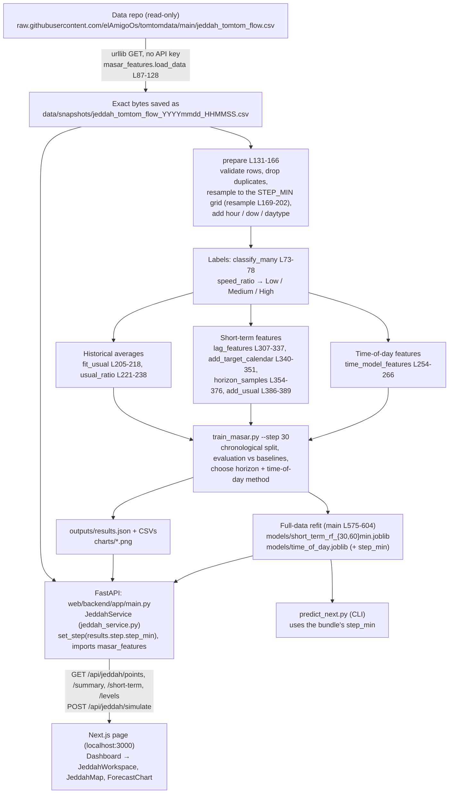

# Masar prototype — end-to-end system trace

**State traced:** the code after the 30-minute-step change, on 24 Oct 2026. That change added a configurable grid step, resampling, the new holdout rule and step-aware backend and UI.
**Training snapshot:** `data/snapshots/jeddah_tomtom_flow_20261024_145800.csv`. It has 18,036 readings at a ~10-minute step, 5 Oct 20:29 → 18 Oct 12:20. Collection stopped on 18 Oct when the monthly TomTom quota ran out.
**Grid step:** 30 min (default), giving 6,056 grid readings.

**How to read this document.**
- Plain statements describe **what the code does**. Each one cites `file:function` and line numbers.
- Paragraphs marked **Interpretation:** are my reading of what it means.
- **Hardcoded**, **Assumption** and **Not implemented** are flagged explicitly where they apply.
- Numbers come from the committed `outputs/results.json`, or were recomputed read-only with the same functions on the training snapshot.

---

## 1. Overview

### 1.1 Pipeline

### 1.2 Files involved

| File | Role |
|---|---|
| `masar_features.py` | The single shared module. It holds the data URL, thresholds, **step settings** (`DEFAULT_STEP_MIN`, `set_step`), `load_data` / `prepare` / `resample`, the labels, historical averages, time-model features, short-term features and target construction. Training, `predict_next.py` and the backend all import it. |
| `train_masar.py` | `--step`; audit, chronological split, evaluation of every method, method/horizon selection, charts, full-data refit, `outputs/results.json`. |
| `predict_next.py` | CLI: loads a full-data RF and forecasts +h min from the newest reading of each point, on the bundle's grid step. |
| `data/snapshots/*.csv` | Dated copies of the downloaded CSV (gitignored). The backend reads the one named in `results.json → data.snapshot`. |
| `models/short_term_rf_{30,60}min.joblib` | Full-data Random Forest pipelines, plus the `usual` tables, the feature list and `step_min`. One file per horizon of the step. |
| `models/time_of_day.joblib` | The selected time-of-day method's state: `method`, `usual` tables, HGB model if selected, and `step_min`. |
| `outputs/results.json` | Data info (including resampling counts), `step`, audit, splits with `split_rule`, all results, the selected horizon/method, and `models` (evaluated vs full-data periods). The web app reads it. |
| `outputs/*.csv`, `outputs/data_audit.json` | Result tables, confusion matrices, `collection_gaps.csv`, audit files, feature importance, latest forecast. |
| `charts/*.png` | Static report figures. The web page does not show them. |
| `web/backend/app/main.py` | FastAPI app and endpoints (Jeddah plus the older NYC endpoints). |
| `web/backend/app/schemas.py` | Request models (`JeddahSimulationRequest`, L13-16). |
| `web/backend/app/services/jeddah_service.py` | Serves Jeddah: point catalog, time-of-day predictions, simulation output, next-hour forecast, summary. |
| `web/backend/scripts/build_jeddah.py` | Checks that the artifacts exist; runs `train_masar.py` with `--retrain` or when something is missing. |
| `web/frontend/src/app/page.tsx`, `components/Dashboard.tsx` | Page shell; `city` state defaults to `"jeddah"`. |
| `web/frontend/src/components/JeddahWorkspace.tsx` | All Jeddah controls, cards, tables and texts. |
| `web/frontend/src/components/JeddahMap.tsx` | MapLibre map with 10 coloured dots. |
| `web/frontend/src/components/ForecastChart.tsx` | Recharts area chart for the 12-hour forecast. |
| `web/frontend/src/components/CitySelect.tsx` | City dropdown; NYC is hidden with `SHOW_NYC = false`. |
| `web/frontend/src/lib/jeddah.ts`, `lib/api.ts`, `lib/format.ts`, `lib/maplibre.ts` | API client and types; `API_BASE` (default `http://127.0.0.1:8000`); formatting (en-GB, `ratioPercent`, `horizonTitle`, `formatClock`); MapLibre worker URL. |

---

## 2. Reading the data

### 2.1 Source and snapshots
- `DATA_URL` is **hardcoded** at `masar_features.py` L23 as the raw GitHub CSV of `elAmigoOs/tomtomdata`. No TomTom API is called anywhere in this repo: the only network read is `urllib.request.urlopen(DATA_URL)` (L98).
- `load_data(csv=None, snapshot_dir)` (L87-128): with no `--csv`, it downloads the file and writes the **exact bytes** to `snapshot_dir/jeddah_tomtom_flow_<local time of download>.csv` (L105), then parses them. With `--csv path`, it reads that file instead and saves nothing.
- `predict_next.py` calls `load_data(args.csv)` **without** a snapshot dir (L35), so its downloads are not saved.
- The snapshot used now is `data/snapshots/jeddah_tomtom_flow_20261024_145800.csv`. `results.json → data.snapshot` and `data.source` both point to it, because the run used `--csv`.
- The backend reads that same file again at start-up (`jeddah_service.py __init__` L39-53). It needs it for the lag features of the next-hour forecast and for the point catalog.
- **Assumption:** raw.githubusercontent.com can lag ~5 min behind the data repo. The code does not check freshness.

### 2.2 CSV columns (22 in the file)

| Used | Where |
|---|---|
| `timestamp_local` | Parsed into `reading_ts` (actual time) and `ts` (grid time) in `prepare` / `resample`. The only time column used. |
| `point_id`, `road` | Keys and labels everywhere. |
| `speed_ratio` | Labels, targets, features, averages. **Taken from the CSV as is, not recomputed.** |
| `current_speed_kmh`, `delay_s` | Short-term lag features (`LAG_COLUMNS` L291). `current_speed_kmh` is also the target of the speed-error metric (`train_masar.evaluate_time_of_day` L303-318) and the "weekday average" in the catalog. |
| `free_flow_speed_kmh` | Feature in both models; converts ratio → km/h. |
| `free_flow_travel_time_s` | Only in the backend catalog: median per point → "Expected delay" (`_build_catalog` L56-78). |
| `frc` | Time-model feature `frc_code` (L249-251) and the catalog label. |
| `lat`, `lon` | Map dot position (catalog). |
| `road_closure` | Audit only: rows written to `outputs/road_closure_rows_for_review.csv` (`audit` L338+). Not used as a feature. |

**Ignored:** `timestamp_utc`, `date_local`, `hour_local`, `day_of_week`, `is_weekend`, `seg_lat`, `seg_lon`, `current_travel_time_s`, `confidence`.
- `congestion_level` from the CSV is **overwritten** with the repo's own classification. On this snapshot both agree on 100% of rows.

### 2.3 Timezone
- The code uses `timestamp_local` as a **naive** datetime. No timezone conversion happens anywhere.
- In this snapshot `timestamp_local − timestamp_utc` is exactly +3:00 for all 18,036 rows (Saudi time, no DST).
- **Assumption:** the collector writes Saudi local time. The browser also parses these strings as naive local times (`format.ts toDate` L9-11), so the displayed wall-clock time is the same in any browser timezone.
- `defaultDate()` (`JeddahWorkspace.tsx` L40-44) uses the **browser's** today.

### 2.4 Cleaning and resampling

`prepare` (`masar_features.py` L131-166) runs these steps in order. Dropped rows are counted under the first rule they fail, in `d.attrs["rows_dropped"]`, and copied into `info["rows_dropped"]`, `data_audit.json` and `results.json`.

| Step | Code | Rows on this snapshot |
|---|---|---|
| `speed_ratio` missing | `prepare` L143+ | **0** dropped |
| `speed_ratio` ≤ 0 or > 1 | same | **0** (min 0.1786, max 1.0) |
| `current_speed_kmh` missing or ≤ 0 | same | **0** |
| `free_flow_speed_kmh` missing or ≤ 0 | same | **0** |
| Duplicate `(point_id, timestamp)` | L156 | **0** |
| **Resample to the step grid** | `resample` L169-202 | 18,036 → **6,056** (11,980 merged) |
| Collection gaps | Rows are **not** removed. Lags across a gap → NaN; targets need a reading within ± half a step. | — |

**Resampling** (`resample`):
- Each reading's time is rounded to the nearest grid time (`dt.round("30min")`, L183) and kept in `reading_ts`.
- If several readings share a grid time for a point, the one closest to it is kept.
- **Why nearest rather than a per-bin mean** (docstring L169-181): after the restart the collector delivers one instantaneous reading per 30-minute slot. Averaging three 10-minute readings would make the old data smoother than the new data.
- On this snapshot the kept reading is on average 0.7 min from its grid time; 36 grid readings are more than 5 min away (max 11 min).

Other points:
- Other columns (`delay_s`, travel times, `frc`, coordinates) are **not validated**. They are clean in this snapshot (no NaN anywhere).
- **Gaps:** `audit` (L338+) lists gaps longer than 1.5 grid steps (45 min at step 30) in `outputs/collection_gaps.csv`. There are 2, both on the evening of 5 Oct (90 and 60 min). Shorter 10-minute gaps disappear on the 30-minute grid.
  - **Interpretation:** the 5 Oct gaps match the GitHub-side outage mentioned by the team.
  - The stop on 18 Oct 12:20 is the end of the data, not a gap.
- **Gap effect on samples (step 30):** 30 grid readings have no valid lag-1 and 80 have no valid lag-6. `horizon_samples` drops 30 readings at both +30 and +60 min, because they have no target within ±15 min.
- **NaN labels:** `classify` (L63-70) and `classify_many` (L73-78) raise `ValueError` on NaN instead of returning "High".
- Speed ratio is capped at 1.0 by the collector: 68.9% of grid readings are exactly 1.0.

---

## 3. Labels

- `speed_ratio` = current speed / free-flow speed, **computed by the collector**.
- Thresholds are **hardcoded** in `masar_features.py` L26-27: `LOW_MIN_RATIO = 0.85`, `MEDIUM_MIN_RATIO = 0.60`.
- Rules (`classify` L63-70, `classify_many` L73-78; both raise on NaN):
  - ratio ≥ 0.85 → **Low**
  - 0.60 ≤ ratio < 0.85 → **Medium**
  - ratio < 0.60 → **High**
  - Exactly 0.60 is Medium.
- Day type: `day_type` (L81-82) gives weekend for `dayofweek` ∈ {4, 5} (Fri, Sat), set by `WEEKEND_DAYS` L28 (**hardcoded**).
- Distribution on the 30-minute grid (6,056 readings): **Low 4,399 (72.6%) · Medium 1,194 (19.7%) · High 463 (7.7%)**. On all 18,036 raw readings: Low 13,080 / Medium 3,596 / High 1,360.
- High per point (grid):
  - Al Haramain 1: 1, 2: 130, 3: 78
  - Al Madinah 1: 0, 2: 9, 3: 83, 4: 62
  - King Abdulaziz 1: 78, 2: 3, 3: 19

---

## 4. Features

### 4.0 Step settings (`masar_features.py` L29-58)
- `DEFAULT_STEP_MIN = 30` (L34, **hardcoded** default). `set_step(step)` (L44-53) sets these process-wide:
  - `STEP_MIN`
  - `TOLERANCE_MIN = step / 2`
  - `HORIZONS_MIN = horizons_for(step)` (L39-41): the horizons in (10, 30, 60) that are multiples of the step. Step 30 → (30, 60); step 10 → (10, 30, 60).
- `N_LAGS = 6` (L36): lag k is k steps back (3 hours at step 30).
- Who calls `set_step`:
  - `train_masar.py` with `--step` (L512-515)
  - the backend, with `results.json → step.step_min` (`__init__` L42-43)
  - `predict_next.py`, with the bundle's `step_min` (L34)

### 4.1 Time-of-day model (`TIME_MODEL_FEATURES` L243-246, built by `time_model_features` L254-266)

| Feature | Computation | Notes |
|---|---|---|
| `minute_sin`, `minute_cos` | sin/cos(2π · minute-of-day / 1440) of the grid time | Cyclic time of day. |
| `is_weekend` | 1 if Fri/Sat | The only calendar input; there is no day of week. |
| `free_flow_speed_kmh` | From the row | Training: per reading. Serving: the **median** per point. |
| `frc_code` | Digits of `frc` | Constant per point. |
| `point_mean` | Mean `speed_ratio` of the point | Fitted on training readings. |
| `point_hour_mean` | Point × hour mean over **all days** (weekday and weekend mixed) | Fitted on training readings. |

These features are only used if the HGB model is selected. **At step 30 it is not selected** (see 5).

### 4.2 Short-term Random Forest (`SHORT_TERM_FEATURES` L293-304)

There are 36 inputs (35 numeric + `point_id`, which is one-hot encoded in `make_rf` L59-69).

| Feature(s) | Computation (`lag_features` L307-337, `add_target_calendar` L340-351, `add_usual` L386-389) |
|---|---|
| `speed_ratio_t`, `current_speed_kmh_t`, `delay_s_t` | The grid reading at time t. |
| `<col>_lag1 … _lag6` (18) | Value k grid steps earlier, kept only if it is at most k·step + step/2 older (L320); otherwise NaN. |
| `ratio_roll3_mean/std`, `ratio_roll6_mean/std`, `delay_roll3_mean` | NaN-ignoring mean/std over the last 3 or 6 grid readings. |
| `ratio_change`, `speed_change`, `delay_change` | Value at t minus lag1. |
| `free_flow_speed_kmh` | Of the reading at t. |
| `target_hour_sin/cos`, `target_dow`, `target_is_weekend` | Calendar of **t + horizon**. |
| `usual_ratio_target` | Historical average for (point, hour of t + h, day type of t + h), with fallbacks. |
| `point_id` | One-hot. |

### 4.3 Historical-average tables (`fit_usual` L205-218)
- The tables are `global`, `point`, `point_hour`, `point_hour_daytype`, plus `_days`, `_p25` and `_p75` per (point, hour, day type), computed on grid readings.
- Lookup order (`usual_ratio` L221-238): point × hour × day type → point × hour → point → global. Sunday uses the weekday table.

### 4.4 Leakage controls
- **Lags** only look backwards. **Targets** are matched by time (`merge_asof`, nearest within ± half a step, L365-373) and dropped if missing (L374).
- **Train/test overlap:**
  - `samples_split` (`train_masar.py` L154-159) keeps a training sample only if its target time is before the cut.
  - `usual` tables and the HGB are fitted on the training readings of the split only (`evaluate_short_term` L190+, `time_of_day_states` L293-300).
- **Interpretation:** `usual_ratio_target` is fitted on the same training period it is used in (in-sample target encoding). It is still the most important RF feature (0.221).

---

## 5. Training

### 5a) Time-of-day methods
- **HGB time model** (`make_time_model` L72-75): `HistGradientBoostingRegressor(max_iter=200, learning_rate=0.05, max_leaf_nodes=15, l2_regularization=1.0, random_state=42)`, target `speed_ratio`. **Hardcoded**, not tuned.
- **Averages:** point × hour, and point × hour × weekday/weekend (`time_of_day_ratio` L276-286).

### 5b) Short-term Random Forest (+30 / +60 min at step 30)
- **Target per horizon** (`horizon_samples` L354-376): the grid reading of the same point at t + h (nearest within ±15 min). If it is missing, the sample is **dropped**.
- **Model** (`make_rf` L59-69): `RandomForestClassifier(n_estimators=300, max_depth=12, min_samples_leaf=5, class_weight="balanced", random_state=42, n_jobs=-1)` with one-hot `point_id`. NaN features are allowed (scikit-learn 1.9.1).

### 5c) Baselines and other models
- **Persistence:** level at t.
- **Historical average:** `classify_many(usual_ratio_target)`.
- **Other models (LR, DT, LSTM…): not implemented.**

### Split (`define_splits` L90-146, `full_weekend` L80-87)

- **Rule:** the test starts at midnight of the most recent Friday that satisfies both conditions:
  - its Fri + Sat are both "full", meaning each day has ≥ 80% of the expected grid readings (**hardcoded** 0.8);
  - training contains at least one other full Fri + Sat that ends by that Friday.
- **Fallback:** if no Friday qualifies, the old rule applies: the latest weekend day that leaves ≥ 3 days of test. `split_rule.fallback` then records it.
- **Latest 20%:** the old "latest 20% of time" split is created but **removed** when it would start within a day of the main test. The reason is recorded in `split_rule.latest_split`. On this data it would start at Fri 16 Oct 00:00, exactly the same test.

| Split | Train | Test | Grid readings train / test | RF samples at +30 / +60 (test) |
|---|---|---|---|---|
| `holdout` "Last 3 days (Fri 16 Oct – Sun 18 Oct)" | 5 Oct 20:30 → 15 Oct 23:30 (includes Fri 9 + Sat 10) | 16 Oct 00:00 → 18 Oct 12:30 | 4,840 / 1,216 | 1,206 / 1,196 (weekend 950 / 940, Sunday morning 256) |

- `split_rule.fallback = false`.
- **Subsets** (`subsets` L162-168): weekday and weekend results are reported separately.

### Metrics (`scores` L173-187)
- **Macro-F1:** the mean of the per-class F1 scores.
- **Accuracy:** share of correct levels.
- **High recall:** share of real High readings predicted High.
- **MAE:** km/h, computed on grid readings.

### Choosing what the app uses
- **Horizon** (`choose_horizon` L219-290): the largest RF − persistence macro-F1 margin on `holdout` → **+60 min** (0.769 vs 0.729).
  - +30 min is within `F1_NOISE = 0.01` (0.832 vs 0.827), so it is listed in `horizons_not_beating_persistence`.
  - With a single test the verdict says "on the test set" (L241-245).
- **Time-of-day method** (`choose_time_method` L321-335): lowest MAE on `holdout` → **point × hour × weekday/weekend average**, ±2.700 km/h vs ±2.712 for the HGB.
  - **Interpretation:** that is a tie (0.012 km/h); the rule has no tie-break.

### Full-data refit (`main` L575-604)
- The code refits on all 6,056 grid readings.
- **Short term:** an RF for each horizon in `HORIZONS_MIN` → `models/short_term_rf_{30,60}min.joblib`, containing `{pipeline, features, horizon_min, step_min, usual, trained_from, trained_through}`.
- **Time of day:** the selected method's state → `models/time_of_day.joblib`, containing `{method, usual, model, label, step_min, …}`. Here `model` is unused because the average was selected.
- `results.json → step` records `step_min` 30, `horizons_min` [30, 60], `target_tolerance_min` 15, `n_lags` 6 and the resampling counts.
- **The full-data models have no score of their own.**

---

## 6. `predict_next.py` and the backend

### `predict_next.py`
- **Arguments:** `--horizon {10,30,60}` (default 30); there must be a model file for it. At step 30, `--horizon 10` stops with "not found - horizons trained at the default step are (30, 60)".
- **Steps:**
  1. Calls `set_step(bundle["step_min"])`; bundles without the field are treated as 10 min.
  2. Loads the data.
  3. Takes the latest grid reading per point and predicts.
- **Output columns:** `latest_reading` (actual time), `latest_slot` (grid time), `forecast_for` (slot + h), levels and probabilities.

### Backend start-up (`JeddahService.__init__` L39-53)
- It reads `results.json` and calls `mf.set_step(results["step"]["step_min"])`; results without `step` are treated as 10 min.
- It re-reads the snapshot through `prepare` (so it gets the same resampling) and loads the models.
- It precomputes the next-hour forecast.
- It is cached with `lru_cache` (L253-255), so the **backend must be restarted** after retraining.

### Jeddah endpoints (`web/backend/app/main.py`)

| Endpoint | Output (key fields) | Uses |
|---|---|---|
| `GET /api/jeddah/summary` (L149) | `data` (period, `rows` = grid readings, `rows_raw`, `step_min`, `horizons_min`, weekday/weekend lists), `models`, `splits` (+ `split_rule`), results | `results.json` |
| `GET /api/jeddah/points` (L154) | 10 catalog entries | Snapshot (grid readings) |
| `GET /api/jeddah/short-term` (L159) | `step_min`, horizon, per point: `latest_timestamp` (grid slot), `latest_reading_time` (actual), `forecast_for`, persistence and model level, probability | Full-data RF |
| `GET /api/jeddah/levels` (L164) | Per point: hour-mean ratio (unrounded), km/h, level | Time-of-day state |
| `POST /api/jeddah/simulate` (L169) | Cards, range, `data_coverage`, method, 12-hour forecast | Time-of-day state, `usual`, catalog |

---

## 7. Every number on the page

### Hour-level prediction (`_ratios`, `jeddah_service.py` L88-101)
- For each point and hour, the code builds one row per grid slot in the hour (`range(0, 60, step)`, L90): **2 slots (:00, :30) at step 30**, 6 at step 10.
- It predicts each slot with the time-of-day state and averages them into `r`.
- With the average method, both slots get the same point × hour × day-type value, so `r` is that value.

| UI element | Calculation |
|---|---|
| **Expected speed** | `round(r × median free-flow speed, 1)`, shown as an integer. |
| **Congestion level** | `classify(r)` (unrounded). |
| **"52–59 km/h on past weekdays"** | p25 / p75 of the **grid** readings for (point, hour, day type) × median free-flow speed. It is an interquartile range. |
| **Speed vs free flow** (L438) | `ratioPercent(r)`: one decimal, truncated. |
| **Expected delay** (`delayText` L59-70) | From exact seconds `fftt / max(r, 0.05)` and `fftt`, rounded once. |
| **Date note** (L457+) | "Depends only on the day type and hour…"; "This is a prediction, not the observed value." for past hours. |
| **Badge / "Usually slowest…" / weekday average** | From the grid readings in the catalog (`_build_catalog` L56-78). |
| **Point / road counts** (L279, `JeddahMap.tsx` L178) | From the catalog. |
| **12-hour chart** | `_ratios` per hour → km/h. |
| **Data coverage** (L482) | `_coverage` (L169-189): distinct days with readings for (point, hour, day type). |
| **Map dots / popup** | `/levels` → level colours; popup with `ratioPercent` (L44, L129). |
| **Footnote / section header** | `readingsText` (L229-233): "6,056 readings on a 30-minute grid, from 18,036 collected". |

### Next-hour section (`NextHourCard` L72+, section L495+)
- **Title:** `horizonTitle(60)` → "Next hour (from latest reading)".
- **Latest reading:** the actual time of the newest reading (`latestReading` L234-237 = max of `latest_reading_time`), plus "(12:30 slot on the 30-minute grid)" (`formatClock`).
- **Forecast for:** `points[0].forecast_for` = slot + 60 min.
- **Per point:** Latest (= persistence), the +60 min model level, and model probability (max class vote share, not calibrated).
- **Note:** built from `horizons_not_beating_persistence` (`horizonNote` L245-252): "At +30 min the model does not beat persistence on the main test, so only +60 min is shown."
- **Next to the selected-time cards** only within 2 h of the latest reading (`nearLatest` L220, **hardcoded** 2 h).

### "How the prediction works"
- The short-term table rows come from `summary.data.horizons_min` (L198), so only +30 and +60 appear.
- Only the main test exists, so there are no "Latest 20%" rows.
- **Weekend note** (`weekendNote` L254+): "The weekend part of the main test is 2 weekend days (Fri 16 Oct, Sat 17 Oct) with 16 High readings at +60 min, so its numbers are especially noisy."

---

## 8. Congestion causes / explanations

**Unchanged: no causal explanation is implemented.** The page shows when congestion happens (hour, day type, 12-hour curve) and the recent state (the next-hour table), but not why.
- **Feature importance:** impurity importance of the full-data +60 min RF is written to `outputs/random_forest_feature_importance.csv` and a chart, **not shown in the UI**. Top features: `usual_ratio_target` 0.221, `speed_ratio_t` 0.099, `current_speed_kmh_t` 0.079, `delay_s_t` 0.059, `ratio_roll3_mean` 0.054, `speed_ratio_lag1` 0.041.
- **SHAP:** not implemented.
- **Incidents:** `jeddah_incidents.csv` is not referenced anywhere in this repo.
- **What could support explanations later:**
  1. the deviation from the `usual` table
  2. the trend features
  3. per-prediction SHAP on the RF
  4. joining incidents and `road_closure` by time and point
  5. FRC and free-flow context

---

## 9. Worked examples (real values, step 30, recomputed read-only)

### 9a) Al Haramain Rd · Point 2, Wed 21 Oct 2026, 17:00 → 54 km/h, High, 59.2%, +9 min

1. **Catalog** (grid readings):
   - median free-flow speed **92.0 km/h**, median free-flow travel time **756 s**, FRC0
   - weekday average 69.9 km/h
   - weekday hourly mean lowest at **12:00** → "High at weekday peak", "Usually slowest on weekdays around 12:00". It was 07:00 in the previous run.
2. **Day type:** Wednesday → weekday. **Method:** point × hour × weekday/weekend average (selected at step 30).
3. **Slots:** 17:00 and 17:30. Both look up `usual[(Al Haramain 2, 17, weekday)]` = **0.592875**, so r = 0.592875.
   - That is the mean of the 16 weekday grid readings at 17:00 and 17:30 over 8 weekdays, which range from 0.4239 to 0.7065.
4. **Expected speed:** 0.592875 × 92 = 54.5 → **54 km/h** (shown as an integer).
5. **Level:** 0.5929 < 0.60 → **High**. **Speed vs free flow:** **59.2%**.
6. **Delay:**
   - travel = 756 / 0.592875 = 1,275.1 s
   - delay = (1,275.1 − 756) / 60 = 8.65 → **+9 min**
   - free flow 756 / 60 = 12.6 → 13 min
   - shown as "(22 min instead of 13 min at free flow)"
7. **Range:** p25 0.5625, p75 0.6411, × 92 = 51.7 – 59.0 → **"52–59 km/h on past weekdays at this hour"**.
8. **Data coverage:** "8 weekdays observed at this hour" (Tue 6, Wed 7, Thu 8, Sun 11, Mon 12, Tue 13, Wed 14, Thu 15).
9. **12-hour chart (km/h):**

   | 17 | 18 | 19 | 20 | 21 | 22 | 23 | 00 | 01 | 02 | 03 | 04 |
   |---|---|---|---|---|---|---|---|---|---|---|---|
   | 54.5 | 59.8 | 58.5 | 74.4 | 80.7 | 78.3 | 82.0 | 89.0 | 90.5 | 90.9 | 91.2 | 92.0 |

10. **Map at that hour:**
    - High: Al Haramain 2 and 3, Al Madinah 3 and 4, King Abdulaziz 1
    - Medium: Al Haramain 1 (76.7%), King Abdulaziz 2 and 3
    - Low: Al Madinah 1 and 2

**Interpretation:** with the average method the prediction is literally "the usual weekday value at 17:00 and 17:30". Every Sun–Thu 17:00 gets the same 54 km/h.

### 9b) Next hour for Al Madinah Rd · Point 3: latest Medium → model High (85%)

1. **Latest reading:** Sun 18 Oct **12:20:28** (12:30 slot): 62 km/h, ratio **0.7848** → **Medium**, so persistence says Medium. Free-flow speed 79 km/h, delay 92 s.
2. **Lags** (12:00 … 09:30 slots): all six are **1.0** (free flow).
   - `ratio_roll3_mean` 0.928, `ratio_roll6_mean` 0.964
   - `ratio_change` −0.215, `speed_change` −17, `delay_change` +92
3. **Target calendar:** 13:30 Sunday → `target_dow` 6, `target_is_weekend` 0, `target_hour_sin/cos` (−0.383, −0.924).
4. **`usual_ratio_target`:** (Al Madinah 3, 13:00, weekday) = **0.5602** over 8 weekdays, i.e. usually High.
   - The observed 13:30 values on past weekdays were 0.475, 0.513, 0.487, 0.494, 0.449, 0.519, 0.475 and 0.544: all High.
   - On weekend days they were all 1.0.
5. **RF `predict_proba`:** High **0.850**, Medium 0.117, Low 0.033 → **High, 85%**.
6. **Interpretation:** the road has just started to slow from free flow (a sharp drop in the last slot). The usual weekday early afternoon here is High. The most important feature (`usual_ratio_target`) and the sudden drop both point towards High.

---

## 10. Limitations

**Hardcoded values:**
- the data URL
- thresholds 0.85 / 0.60 and the matching hint
- weekend = Fri/Sat
- the default step 30, N_LAGS 6, the tolerance (step / 2) and the horizon set (10, 30, 60)
- the 80% "full weekend" share and the "within a day" rule for skipping the latest split
- the 1.5-step gap limit
- RF and HGB hyperparameters
- `F1_NOISE` 0.01
- the default hour 17
- the 2-hour "near latest reading" window
- the < 30 High "especially noisy" cut-off
- `max(r, 0.05)`

**Assumptions:**
- `timestamp_local` is Saudi time.
- The collector's values are correct.
- One reading represents its whole 30-minute slot. **No real 30-minute data exists yet:** the grid is built from 10-minute data. Readings from a 30-minute collector may drift within the slot (GitHub Actions start times vary); the nearest-reading rule handles that, but it is untested on real 30-minute data.

**Small data:**
- 14 days and 2 weekends, one in training and one in the test.
- The test is mostly weekend: the weekday part is only Sunday morning (12 High readings).
- 28–29 High readings in the test in total.
- The time-of-day choice is a tie.

**Behaviour to be aware of:**
- The **last collection run (18 Oct 12:20) has readings for only 6 of the 10 points.** The other 4 points' newest slot is 12:00, so their next-hour forecast is for 13:00, not 13:30. The section header shows `points[0].forecast_for` only.
- The time-of-day prediction ignores the date (page note explains it).
- At step 30 the selected average method uses no time-of-day model at all.
- The catalog, badge, IQR range and data coverage use the full snapshot (not out-of-sample).
- The next-hour forecast is fixed at backend start-up.
- `set_step` changes module-level settings for the whole process. The backend and CLI set it once at start, so a single process cannot serve two steps at once.

**UI text vs code — still open:**
1. The "52–59 km/h on past weekdays" range is an interquartile range, not a full range.
2. "Data: …, 14 days" counts calendar days, including partial ones.
3. `results.json → data.source` shows the snapshot path after a `--csv` run.
4. The weekend note / badge text and the threshold hint are fixed strings.
5. The time-of-day method label reads "Historical average (pilot) (point x hour x weekday/weekend)", with doubled brackets.

---

## 11. Glossary

| Term | Meaning here |
|---|---|
| **speed_ratio** | Current speed ÷ free-flow speed for a TomTom segment (1.0 = free flowing), from the collector. |
| **Grid step** | The regular time grid the readings are resampled to (30 min by default). |
| **Grid time / slot** | A time on that grid (e.g. 12:30); each point has at most one reading per slot. |
| **Resampling (nearest reading)** | Assigning each reading to the nearest grid time and keeping the closest one per slot. |
| **Low / Medium / High** | Congestion levels from speed_ratio: ≥ 0.85 / 0.60–0.85 / < 0.60. |
| **Day type** | weekday (Sun–Thu) or weekend (Fri, Sat). |
| **Horizon** | How far ahead the short-term model predicts: +30 or +60 min at step 30. |
| **Persistence** | Baseline: "the level in h minutes = the level now". |
| **Historical average ("usual")** | Mean speed_ratio for a point × hour (× day type), from training readings. |
| **Lag** | The value k grid steps earlier, empty across a gap. |
| **Chronological split / holdout** | Train on earlier time, test on later time; here the test is Fri 16 → Sun 18 Oct. |
| **Full weekend** | A Fri + Sat where each day has ≥ 80% of the expected grid readings. |
| **Leakage** | Information from the test period or the future reaching training. |
| **Macro-F1** | The average F1 of Low, Medium and High, each counted equally. |
| **High recall** | Share of real High readings predicted as High. |
| **MAE (speed error)** | Mean absolute difference between predicted and observed speed, km/h. |
| **Evaluated model** | Trained on the train part of the split; the source of all scores. |
| **Refit / full-data model** | The same settings retrained on all data after evaluation; used for every prediction; no score of its own. |
| **Random Forest / Gradient boosting** | Tree ensembles: voting classifier for the level / sequential regressor for speed_ratio. |
| **Model probability** | The forest's average vote share for the predicted class; not calibrated. |
| **Feature importance (impurity)** | Global contribution of each feature to the RF's splits. |
| **SHAP** | A per-prediction attribution method; not implemented. |
